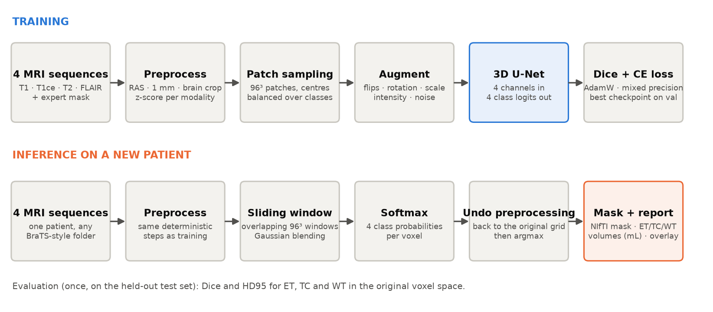
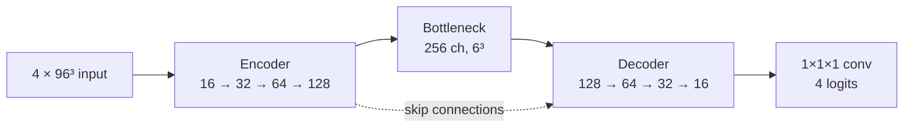
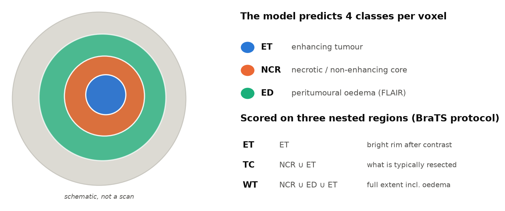

# 3D Brain Tumour Segmentation from Multi-parametric MRI

A reproducible **PyTorch + MONAI** pipeline that trains a **3D U-Net** to segment glioma sub-regions in
multi-parametric brain MRI ([BraTS 2023](https://www.synapse.org/Synapse:syn51156910/wiki/621282) data).
Four MRI sequences go in, a voxel-wise tumour mask comes out: location, shape and volume of the
enhancing tumour, the tumour core and the whole tumour.

  

> **Not a medical device.** This is a research and educational project. It is not clinically validated and
> must not be used for diagnosis, treatment planning or any clinical decision.

## Status

| | |
|---|---|
| Code | Complete. **64 unit tests** pass (on synthetic phantoms that live only in `tests/`; the library refuses phantom data elsewhere). |
| Real data | BraTS 2023 Adult Glioma training set downloaded and validated: **1251 complete cases, 1133 patients**, 4 modalities + mask each, no geometry errors. |
| Pilot | A short real-data pilot on a Colab T4 ran end to end: the loss decreased and validation Dice rose. A pilot is a sanity check, **not a result**. |
| Baseline run | **Done:** 20 epochs on a free Colab T4 in about 35 minutes of training, using 250 of the 874 training cases. Evaluated once on the held-out test set (194 cases), see [Results](#results). |
| Next | Longer training on all training cases, a larger patch and model, post-processing and test-time augmentation (see [Future improvements](docs/reference.md#future-improvements)). |

## How it works



1. **Preprocess** (deterministic, identical for training and inference): reorient to RAS, resample to 1 mm,
   crop to the brain, z-score every modality over brain voxels only.
2. **Sample patches**: the volume is too large for a GPU, so the network trains on 96³ patches. Patch
   centres are drawn per class (background / necrosis / oedema / enhancing), so the tiny tumour classes
   are seen far more often than their voxel share (about 0.1 to 1 percent) would suggest.
3. **Segment with a 3D U-Net**: an encoder-decoder with skip connections outputs 4 class logits per voxel.
   Loss: Dice (tumour classes) + cross-entropy (all classes).
4. **Infer on whole volumes**: overlapping windows with Gaussian blending, then the preprocessing is
   **inverted**, so masks align voxel for voxel with the original scan.



The default model has **5.65 M parameters** (instance norm, LeakyReLU). Details and the reasoning behind
each choice: [docs/methodology.md](docs/methodology.md).

### What is being segmented



| Sequence | Shows best |
|---|---|
| T1 | anatomy; necrosis is dark |
| T1ce (after gadolinium) | **enhancing tumour** (bright rim) |
| T2 | fluid; tumour core and oedema are bright |
| FLAIR | **oedema** (bright, CSF suppressed) |

## Figures from your own data

No MRI scans or other BraTS files are included in this repository: the BraTS data-use terms forbid
redistributing them. After you download the data yourself, the project generates its figures locally:
an overview of one case (all four modalities with the expert mask), training curves, per-case Dice plots and
prediction overlays.

```bash
python scripts/visualize.py case --config configs/default.yaml --data-root "$DATA" --case-id BraTS-GLI-00000-000
```

## What is in the box

* **Verified, not assumed:** label conventions are detected from the masks, unknown label values raise an
  error, and file geometry (shape, spacing, orientation) is checked for every case before training.
* **No patient leakage:** the 70/15/15 split is made at the *patient* level (118 patients have more than one
  scan) and verified; the test set is evaluated once.
* **Clinically meaningful metrics:** Dice and HD95 for ET / TC / WT in the *original* voxel space, with explicit,
  documented conventions for empty masks.
* **Fits small hardware:** mixed precision on CUDA, patch-based training, sliding-window inference, and a compact
  **float16/uint8 disk cache** (`data.cache: npy`, about 3-4x smaller than MONAI's cache on full-size phantoms)
  for 2-CPU machines such as free Colab.
* **Budget-aware and resumable:** `train.max_hours` never starts an epoch that will not fit, validates once more
  and writes a checkpoint you can resume from.
* **Reproducible:** typed YAML configs with inheritance, every run stores its config, split, environment and
  history next to the checkpoints.
* **Tested:** unit tests for labels, metrics, data discovery, splits, caches, the model, losses and the whole
  train / evaluate / predict loop.

## Quick start

```bash
git clone <this-repo-url> && cd brain-tumor-segmentation
python -m venv .venv && source .venv/bin/activate
pip install -e ".[dev]"          # on a CUDA machine install PyTorch first (see docs/reference.md)
pytest -q                        # ~10 s, synthetic phantoms only
```

Get the data (needs your own Synapse account and acceptance of the terms, see
[Getting the data](docs/reference.md#getting-the-data)), then:

```bash
export DATA=/path/to/ASNR-MICCAI-BraTS2023-GLI-Challenge-TrainingData
python scripts/inspect_dataset.py --data-root "$DATA"                                  # validate the dataset
python scripts/smoke_test.py --config configs/local_mps.yaml --data-root "$DATA"       # one step, memory, speed
python scripts/train.py --config configs/pilot.yaml --data-root "$DATA" --run-name pilot   # short sanity run
```

| Where | Config | Notes |
|---|---|---|
| Apple Silicon Mac | `configs/local_mps.yaml` | development and pilots |
| NVIDIA GPU (rented) | `configs/cloud_cuda.yaml` | full training, see [docs/cloud_gpu.md](docs/cloud_gpu.md) |
| Free Colab T4, about 1 hour | `configs/colab_t4_1h.yaml` | subset of the data, compact cache, time cap |

Evaluate the best checkpoint on the held-out test set (once) and segment a new patient:

```bash
python scripts/evaluate.py --checkpoint outputs/runs/<run>/checkpoints/best.pt --data-root "$DATA"
python scripts/predict.py  --checkpoint outputs/runs/<run>/checkpoints/best.pt --input-dir /path/to/patient --output-dir outputs/predictions
```

## Results

Baseline run `colab_1h` (`configs/colab_t4_1h.yaml`), evaluated **once** on the held-out test set of
194 cases (patient-level split, seed 42), in the original voxel space. Best checkpoint chosen on a 20-case
validation subset; the test set was not used for any decision.

| Region | Dice mean ± std | Dice median | HD95 mean (mm) | HD95 median (mm) | Sensitivity | Precision |
|---|---|---|---|---|---|---|
| ET (enhancing tumour) | 0.825 ± 0.188 | 0.887 | 6.99 | 2.24 | 0.839 | 0.858 |
| TC (tumour core) | 0.871 ± 0.175 | 0.933 | 8.91 | 2.83 | 0.861 | 0.914 |
| WT (whole tumour) | 0.903 ± 0.095 | 0.928 | 10.44 | 3.74 | 0.885 | 0.937 |

Mean of the three regional Dice values per case: **0.866** (median 0.908). Test set: 194 cases.

Source: `eval_test/summary.md` of this run. Dice uses the BraTS convention that a correctly empty prediction scores 1.0
(5 test cases have an empty ET reference mask, 1 an empty TC mask, none an empty WT mask). Undefined values are
excluded from the means: HD95 is based on 191 (ET), 193 (TC) and 194 (WT) cases, sensitivity on 189 / 193 / 194 and
precision on 192 / 192 / 194.

**How to read this honestly**

* This is a deliberately small run: a 5.65 M-parameter model, 96³ patches, **250 of 874 training cases**, 20 epochs
  (about 35 minutes on a free T4). It is a baseline, not the best this code can do.
* The median is clearly higher than the mean for ET and TC: most cases are segmented well, while a few
  fail badly (the minimum Dice is 0.00 for ET and TC, and 0.13 for WT). The same is visible in HD95, whose mean
  (7-10 mm) is several times the median (2-4 mm) because of a few far-off errors (maximum about 106-108 mm for ET and TC).
  Look at the per-case table (`eval_test/per_case_metrics.csv`) and the worst cases, not only at the means.
* Precision is higher than sensitivity in every region: on average the model under-segments (misses some tumour)
  rather than over-segments.
* One run, one seed: there is no confidence interval, so small differences between future runs are not meaningful.
* BraTS 2023 data, trained and tested on cases from the same release; performance on other scanners or
  populations is not known.

## Documentation

| Document | Contents |
|---|---|
| [docs/reference.md](docs/reference.md) | Full reference: dataset, method, installation, workflow, hardware settings, experiments, limitations |
| [docs/methodology.md](docs/methodology.md) | Why the pipeline is built this way; evaluation protocol |
| [docs/cloud_gpu.md](docs/cloud_gpu.md) | Renting a GPU, persistence, exact cloud commands |
| [docs/data_report.md](docs/data_report.md) | Measured facts about the downloaded BraTS data and the T4 benchmark |
| [docs/improvements_report.md](docs/improvements_report.md) | What was changed in the code review and why |

## Repository layout

```text
configs/      YAML configs (default, Mac, cloud GPU, Colab T4, pilot, experiments)
src/brain_seg/  config, labels, data, transforms, model, losses, metrics, train, evaluate, inference, visualize
scripts/      command-line entry points (inspect_dataset, smoke_test, train, evaluate, predict, visualize, ...)
tests/        pytest suite (synthetic phantoms live only here)
docs/         documentation and figures
```

## Limitations and ethics

* Trained on skull-stripped, co-registered, 1 mm BraTS data. Other scans are out of distribution and give
  unreliable masks. A single model, no ensembling or post-processing.
* A high mean Dice can hide clinically important failures (small enhancing lesions), so inspect the worst cases.
* BraTS images are de-identified patient data: respect the data-use agreement, do not redistribute the files and
  do not commit them (`.gitignore` excludes `*.nii*`, checkpoints and `outputs/`).
* Full list: [Limitations](docs/reference.md#limitations) and [Ethical considerations](docs/reference.md#ethical-considerations).

## Data attribution and citations

*"Data used in this publication were obtained as part of the Brain Tumor Segmentation (BraTS) Challenge project
through Synapse ID: syn51156910."* The data licence is CC-BY-NC 4.0 (non-commercial). Full citation list:
[docs/reference.md](docs/reference.md#citations-and-attribution). The code in this repository is by its author; choose and
add a `LICENSE` file before publishing.
