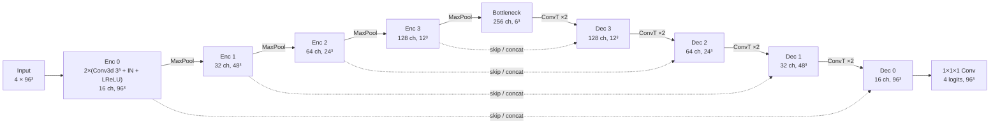

# Reference documentation

Full reference for the 3D brain tumour segmentation project: dataset, method, installation, workflow, hardware settings, experiments and limitations. The project overview is in the [README](../README.md).

A reproducible PyTorch + MONAI pipeline that trains a **3D U-Net** to segment glioma
sub-regions in BraTS MRI volumes. It is meant to be trained on your own hardware: development
and tests run on an Apple Silicon Mac (MPS), and full training on a rented NVIDIA GPU (see [docs/cloud_gpu.md](cloud_gpu.md)).

> **Not a medical device.** This is a research and educational project. It is not clinically
> validated and must not be used for diagnosis, treatment planning or any clinical decision.

**Status (honest summary):**
* The code is complete. 64 unit tests pass; they use geometric phantoms that exist **only inside `tests/`** and
  the library refuses phantom data outside the test suite.
* **No model has been trained or evaluated on real BraTS data yet.** The data requires a personal Synapse login and
  acceptance of the dataset terms, which cannot be done on your behalf (see [Getting the data](#getting-the-data)).
  Therefore this README contains **no Dice scores**; [Results](#results) stays an empty template until a real run exists.

---

## Contents
1. [Problem definition](#problem-definition)
2. [Dataset](#dataset)
3. [Method](#method) (preprocessing, model, loss, inference, metrics)
4. [Installation](#installation)
5. [Workflow: Mac → cloud GPU](#workflow-mac--cloud-gpu)
6. [Choosing settings for your hardware](#choosing-settings-for-your-hardware)
7. [Experiments](#experiments)
8. [Results](#results)
9. [Testing](#testing)
10. [Project structure](#project-structure)
11. [Limitations, ethics, future work](#limitations)

---

## Problem definition

Given four co-registered MRI sequences of one patient, predict for **every voxel** whether it
belongs to background, necrotic/non-enhancing tumour core (NCR), peritumoural oedema (ED) or
enhancing tumour (ET). Performance is reported on the three nested regions used by the BraTS
challenge:

| Region | Definition | Clinical meaning (simplified) |
|---|---|---|
| **ET** enhancing tumour | ET | actively enhancing (blood-brain-barrier breakdown) tumour |
| **TC** tumour core | NCR ∪ ET | what is typically resected |
| **WT** whole tumour | NCR ∪ ED ∪ ET | full extent of abnormality incl. oedema |

**Segmentation vs. classification.** A *classification* model outputs one label per scan (e.g.
"high-grade glioma: yes/no"). A *segmentation* model outputs a label **per voxel**: a 3D mask
with the same shape as the input. The mask gives location, shape and volume, which a
classification model cannot. The two tasks also need different evaluation: overlap metrics
(Dice, HD95) for segmentation, accuracy/AUC for classification.

### MRI modalities

| Channel | Sequence | What it shows best |
|---|---|---|
| `t1` | native T1-weighted | anatomy; necrosis appears dark |
| `t1ce` | T1-weighted after gadolinium contrast | **enhancing tumour** (bright rim) |
| `t2` | T2-weighted | fluid; tumour core and oedema bright |
| `flair` | T2 fluid-attenuated inversion recovery | **oedema** (bright, CSF suppressed) |

The network sees all four as channels of one 3D tensor, in this fixed order.

---

## Dataset

<a id="getting-the-data"></a>
### Getting the data

**Dataset:** BraTS 2023 *Adult Glioma* segmentation (BraTS-GLI) from the
[BraTS 2023 Challenge on Synapse](https://www.synapse.org/Synapse:syn51156910/wiki/622351). According to the
challenge page it is the same data as BraTS 2021/2022 (1,470 glioma patients across the training and the mask-free
validation archives), with expert-annotated, co-registered, skull-stripped 1 mm³ volumes. Labels: 1 = necrotic core
(NCR), 2 = oedema (ED), **3 = enhancing tumour (ET)**, 0 = everything else. The 2025 Lighthouse challenge has an updated,
differently pre-processed version; this project targets the 2023 files named below.

**Access and licence** (from the [Data Access page](https://www.synapse.org/Synapse:syn51156910/wiki/627000)): free for registered
Synapse users who accept the post-challenge terms. The data are **CC-BY-NC**: non-commercial use only, with attribution
(see [Citations](#citations-and-attribution)). By downloading you also consent to Sage Bionetworks sharing your Synapse
username/download activity with the organisers. This repository does not bundle or redistribute any data.

**What you need to do once (about 5 minutes, only you can do it):**
1. Register or log in at <https://www.synapse.org>.
2. Open <https://www.synapse.org/Synapse:syn64952532>, click **Request Access**, read and accept the terms.
3. Account Settings → Personal Access Tokens → create a token with *View* and *Download* scopes.

**Then download** the training archive `ASNR-MICCAI-BraTS2023-GLI-Challenge-TrainingData.zip` (Synapse ID `syn51514132`;
the only archive with masks; `...ValidationData.zip` has none and is not usable for local evaluation). Either click
*Download* in the browser, or use the helper, which reads your token from the environment, checks free disk space,
verifies and unpacks the archive:

```bash
pip install -e ".[download]"
```
```bash
export SYNAPSE_AUTH_TOKEN=<your token>   # PowerShell: $env:SYNAPSE_AUTH_TOKEN="<your token>"
```
```bash
python scripts/download_brats.py --output-dir ~/data/brats2023
```

Treat the token like a password: do not paste it into chat or commit it. `scripts/download_brats.py` is untested against the
live Synapse service (no credentials were available in development); its error paths and archive-safety checks are tested.

Other releases (BraTS 2018-2021 with ET = 4, custom layouts) are supported through profiles:

| Release | Profile | File naming | Label IDs |
|---|---|---|---|
| **BraTS 2023 GLI** (target of this project) | `brats2023` | `BraTS-GLI-00000-000-{t1n,t1c,t2w,t2f,seg}.nii.gz` | 0, 1 NETC, 2 SNFH, **3 ET** |
| BraTS 2018-2021 | `brats2021` | `BraTS2021_00000_{t1,t1ce,t2,flair,seg}.nii.gz` | 0, 1 NCR, 2 ED, **4 ET** |
| Anything else | `custom` | configurable aliases | configurable `label_map` |

The file names above follow the challenge documentation and the loader's tests; they have not yet been checked against the real
archive. `scripts/inspect_dataset.py` is the first thing to run on it: it reports unrecognised files, the label values found, and
geometry problems before anything is trained. BraTS 2024 post-treatment (extra label 4 = resection cavity) and the Medical
Segmentation Decathlon Task01 (4D files) are **not** handled automatically; use a `custom` profile with a verified `label_map`.

### Expected directory structure

Point `--data-root` at the folder that contains the case folders. Nested and flat layouts both
work, because cases are grouped by filename prefix:

```text
BraTS2021_Training_Data/                 BraTS2023-GLI-Training/
├── BraTS2021_00000/                     ├── BraTS-GLI-00000-000/
│   ├── BraTS2021_00000_flair.nii.gz     │   ├── BraTS-GLI-00000-000-t1c.nii.gz
│   ├── BraTS2021_00000_t1.nii.gz        │   ├── BraTS-GLI-00000-000-t1n.nii.gz
│   ├── BraTS2021_00000_t1ce.nii.gz      │   ├── BraTS-GLI-00000-000-t2f.nii.gz
│   ├── BraTS2021_00000_t2.nii.gz        │   ├── BraTS-GLI-00000-000-t2w.nii.gz
│   └── BraTS2021_00000_seg.nii.gz       │   └── BraTS-GLI-00000-000-seg.nii.gz
└── BraTS2021_00001/ ...                 └── ...
```

### Label conventions are verified, not assumed

* `data.profile: auto` reads label values from real masks: `{0,1,2,4}` → `brats2021`,
  `{0,1,2,3}` → `brats2023`, both 3 and 4 → error (needs a `custom` profile).
* Raw IDs are mapped to **canonical classes** `0 BG, 1 NCR, 2 ED, 3 ET` right after loading. Any
  label value not in the profile raises an error naming the file.
* Predictions are written back in the dataset's own convention (e.g. ET = 4 for 2021), or in the
  canonical one with `--label-convention canonical`.

### Validation of input files

Before training, every case is checked: all modalities and the mask must be present, there must
be no duplicates, every volume must be 3D, and all files must share shape and affine (header-only
read). Incomplete cases stop training with a list of problems, unless you set
`data.skip_invalid_cases: true`, in which case they are excluded and listed in the log. One known
real-world example: in BraTS 2020, case 355's mask is named `W39_1998.09.19_Segm.nii`; rename it
to `BraTS20_Training_355_seg.nii`. macOS `._*` resource-fork files are ignored.

### Splits

* Splits are made **by patient**, never by slice or patch. For BraTS 2023, several timepoints of
  one patient (`…-00001-000`, `…-00001-001`) always land in the same subset.
* Default: 70 / 15 / 15 % train / val / test, `split_seed: 42`, written to
  `outputs/splits/split_seed42.json` and reused on every later run, so all experiments share the
  same test set. Each run also stores its own copy in `runs/<run>/split.json`.
* **Validation** is used for checkpoint selection and early stopping. **Test** is used once, by
  `scripts/evaluate.py`, after you have chosen your model, and never for tuning.
* To use your own split, write a JSON file with `train`/`val`/`test` case-ID lists and set
  `data.split_file`.

---

## Method

### Preprocessing (`src/brain_seg/transforms.py`)

1. Load the four modalities as channels `(4, X, Y, Z)` and the mask as `(1, X, Y, Z)`.
2. Map raw labels → canonical classes (error on unknown values).
3. Reorient to **RAS**, resample to **1 mm isotropic** (bilinear for images, nearest for masks).
4. Crop to the brain bounding box (non-zero voxels), which typically removes more than half of a 240×240×155 volume.
5. **Z-score** each modality using brain voxels only (MRI intensities have no absolute scale).

Training only: pad to the patch size, sample **patches** (default 96³) with class-balanced
centres (`label_sampling_ratios: [1,1,1,1]` for BG/NCR/ED/ET, so ~75% of patches are centred on a
tumour voxel although tumour is only a few percent of brain voxels), then augment: random flips, small rotations/scaling
(p = 0.2), intensity scale/shift and Gaussian noise.

### Model: 3D U-Net (`src/brain_seg/model.py`)



* **Encoder:** at each level, two 3×3×3 convolutions with instance normalisation and LeakyReLU,
  then 2× max-pooling. The network learns increasingly abstract features at lower resolution.
* **Bottleneck:** the lowest-resolution, widest block (6³ for a 96³ patch). It has the largest
  receptive field and captures context such as "where in the brain is this lesion".
* **Decoder:** transposed convolutions upsample 2×. The result is **concatenated with the encoder
  features of the same resolution (skip connections)** and refined by two convolutions. Skips
  restore fine boundary detail lost by pooling.
* **Head:** a 1×1×1 convolution maps to 4 logits per voxel.
* Default `features: [16, 32, 64, 128, 256]` → **5.65 M parameters**; patch sides must be divisible
  by 2⁴ = 16. Instance norm is used because batches are tiny (1–2 patches) and batch statistics
  would be noisy. `model.name: monai_unet` swaps in MONAI's residual U-Net for comparison.

**Output representation.** Labels are mutually exclusive, so the model predicts a 4-class
**softmax** per voxel. The prediction is `argmax` over the 4 classes, giving a label map with
values 0–3, and the ET/TC/WT masks are derived from that label map. (Training the three
overlapping regions with sigmoid outputs is a common alternative; see future work.)

### Loss and class imbalance (`src/brain_seg/losses.py`)

`loss = Dice(NCR, ED, ET) + CrossEntropy(BG, NCR, ED, ET)` (MONAI `DiceCELoss`, softmax +
one-hot targets inside the loss, so representation and target encoding always match).

* **Dice** is computed per class and averaged, so a class with 0.1% of voxels counts as much as
  one with 5%. Background is excluded from the Dice term because it would dominate it.
* **Cross-entropy** gives smooth, well-conditioned per-voxel gradients early in training.
* `batch=True` pools Dice statistics over the batch, so a patch that happens to contain no ET does
  not produce an unstable 0/0 term.
* Imbalance is also handled by **class-balanced patch sampling** (above). Optional CE class
  weights and Dice + focal loss are available for experiments.

### Training (`src/brain_seg/train.py`)

AdamW (lr 2·10⁻⁴, weight decay 10⁻⁵), 5-epoch linear warm-up, then cosine decay to 10⁻⁶; gradient
clipping (norm 12); optional gradient accumulation. Every `val_interval` epochs the model is
validated on **full volumes** with sliding-window inference. The **selection metric** is
`val_dice_mean`: the mean of ET, TC and WT Dice per case, averaged over validation cases.
`best.pt` holds the best epoch so far and `last.pt` the latest completed epoch, which is used for
resuming. Early stopping triggers after `early_stopping_patience` validation rounds without
improvement. A NaN/inf loss stops training with an error instead of continuing.

### Inference on whole volumes (`src/brain_seg/inference.py`)

Training uses patches, but scans are larger. At inference, the preprocessed volume is tiled with
overlapping patch-sized windows (`inference.overlap: 0.5`), and window logits are blended with a
Gaussian weight. Softmax probabilities are then **mapped back through the inverse of crop →
resampling → reorientation** (MONAI `Invertd`) to the original voxel grid, and only then turned
into labels with argmax. The code checks that the output shape equals the input file's shape.
Saved masks reuse the input's affine and header, so they overlay exactly in any NIfTI viewer
(ITK-SNAP, 3D Slicer).

### Metrics (`src/brain_seg/metrics.py`, `src/brain_seg/evaluate.py`)

Computed per case on **binary region masks** in the **original voxel grid**, against the reference
mask loaded directly from disk:

* **Dice** = 2|P∩R| / (|P|+|R|), **IoU** = |P∩R| / |P∪R|, **sensitivity** = |P∩R| / |R|,
  **precision** = |P∩R| / |P|, **HD95** (95th-percentile Hausdorff distance, mm).
* **Empty masks** (common for ET; some tumours do not enhance):

| Reference | Prediction | Dice / IoU | Sensitivity | Precision | HD95 |
|---|---|---|---|---|---|
| empty | empty | 1 | NaN | NaN | 0 |
| empty | non-empty | 0 | NaN | 0 | NaN |
| non-empty | empty | 0 | 0 | NaN | NaN |

  Dice/IoU follow the BraTS convention. NaN means undefined: these values are excluded from
  aggregates, and `n` reports how many were used. The CSV keeps reference/prediction voxel counts
  per region, so you can re-aggregate under another convention.
* Reports: `per_case_metrics.csv`, mean / median / std (ddof = 1) / min / max in `summary.json`
  and `summary.md`, a Dice distribution plot, and best/median/worst case figures.

---

## Installation

Tested environment: **macOS 26, Apple M4 (16 GB), Python 3.12.15**, torch 2.15.0, MONAI 1.6.1,
nibabel 5.4.2, NumPy 2.5.4 (exact pins in `requirements.txt`). CUDA could not be tested on this
machine; the CUDA code path uses only standard PyTorch AMP APIs.

### macOS (Apple Silicon)

```bash
git clone <your-repo-url> brain-tumor-segmentation
```
```bash
cd brain-tumor-segmentation
```
```bash
python3.12 -m venv .venv
```
```bash
source .venv/bin/activate
```
```bash
pip install -r requirements.txt
```
```bash
pip install -e ".[dev]"
```

(With [uv](https://docs.astral.sh/uv/): `uv venv --python 3.12 .venv && uv pip install -r requirements.txt -e ".[dev]"`.)

### Linux with an NVIDIA GPU

Install a CUDA build of PyTorch first (pick the command for your driver at
<https://pytorch.org/get-started/locally/>), then:

```bash
pip install -e ".[dev]"
```

`pyproject.toml` only sets lower bounds, so an existing CUDA PyTorch is kept.

### Google Colab

Colab already ships a CUDA build of PyTorch, so install only the project (Runtime → Change
runtime type → GPU):

```python
from google.colab import drive
drive.mount("/content/drive")
!git clone <your-repo-url> /content/brain-tumor-segmentation
%cd /content/brain-tumor-segmentation
!pip install -q -e ".[dev]"
!nvidia-smi
```

### Windows (PowerShell)

```powershell
py -3.12 -m venv .venv
.venv\Scripts\Activate.ps1
# install PyTorch first with the command pytorch.org gives for your CUDA version (or CPU)
pip install -e ".[dev]"
```

On Windows, use backticks (`` ` ``) instead of `\` to continue lines, and `$env:DATA="D:\BraTS2021"`
instead of `export DATA=...`.

---

## Workflow: Mac → cloud GPU

All commands run from the repository root with the virtual environment active.

> **zsh (macOS default shell):** always quote overrides that contain brackets, e.g.
> `--set "train.patch_size=[64,64,64]"`. Without quotes zsh treats `[...]` as a glob and fails
> with `no matches found`.

### 1. Run the unit tests (~10 s)

```bash
pytest -q
```

These check software components on tiny synthetic phantoms. Passing them says nothing about segmentation quality.

### 2. Get and validate the real dataset

Follow [Getting the data](#getting-the-data), then:

```bash
export DATA=~/data/brats2023
```
```bash
python scripts/inspect_dataset.py --data-root "$DATA"
```

Check the output: the number of complete cases, detected label convention (`brats2023`: values 0-3), no geometry errors,
no unrecognised files. The report covers complete/incomplete cases, the label convention **detected from mask values**,
patients vs. cases, shapes/spacings/orientations, and label frequencies; a JSON copy goes to `outputs/dataset_report.json`.
Use `--max-label-cases 0` to read every mask (slower). For an interactive look at a case run
`pip install -e ".[notebook]"` once, then `BRATS_ROOT="$DATA" jupyter lab notebooks/exploration.ipynb`.

```bash
python scripts/smoke_test.py --config configs/local_mps.yaml --data-root "$DATA"
```

This pushes real batches through the real pipeline, checks shapes/labels, runs one forward/backward step and one full-volume
inference, and **measures s/step** (data loading included) on the device you are using.

### 3. Pilot run on the Mac (free; do this before renting a GPU)

```bash
python scripts/train.py --config configs/pilot.yaml --data-root "$DATA" --run-name pilot_mps
```

The pilot trains on 40 real training cases for 12 epochs and validates on 10 real validation cases. Confirm in
`outputs/runs/pilot_mps/train.log` that the training loss decreases and that validation Dice (ET/TC/WT) is computed and rising.
Pilot numbers are a pipeline check, not results.

### 4. Train the baseline

On the Mac (slow, fine for experiments; see [hardware table](#choosing-settings-for-your-hardware)):

```bash
python scripts/train.py --config configs/local_mps.yaml --data-root "$DATA" --run-name mps_baseline
```

For the full run use a rented NVIDIA GPU: **[docs/cloud_gpu.md](cloud_gpu.md)** has the recommendation, persistence setup and
copy-paste commands. In short: attach a persistent volume, download the data there with your token, run the smoke test to
measure peak GPU memory and s/step, budget from those measurements, then train inside `tmux` with `train.max_hours` as a hard
cost cap. To watch progress, run `tensorboard --logdir outputs/runs`; curves are also saved as PNGs in
`outputs/runs/<run>/figures/` after every validation.

### 5. Persist results

Everything a run produces lives in `outputs/runs/<run>/`. On a rented machine put `output_dir` on a persistent volume or
mirror it with `scripts/sync_outputs.sh`; see [docs/cloud_gpu.md](cloud_gpu.md).

### 6. Resume after an interruption

Ctrl+C, a closed laptop or a Colab disconnect leaves `last.pt` from the last **completed** epoch
(checkpoints are written atomically). Resuming restores model, optimizer, LR scheduler, AMP scaler,
history, best score and early-stopping counter, and continues in the same run directory:

```bash
python scripts/train.py --resume outputs/runs/mps_baseline/checkpoints/last.pt --data-root "$DATA"
```

```python
!python scripts/train.py --resume {OUT}/runs/cuda_baseline/checkpoints/last.pt --data-root {DATA}
```

Add `--set train.epochs=400` to extend a finished run.

### 7. Evaluate the best checkpoint on the held-out test set

```bash
python scripts/evaluate.py --checkpoint outputs/runs/mps_baseline/checkpoints/best.pt --data-root "$DATA"
```

This uses the split stored with the run and writes `eval_test/` inside the run directory. To
evaluate a cloud run on the Mac, copy the whole run directory (it contains `split.json` and
`config.yaml`), not just `best.pt`. Use `--subset val` while you are still choosing between
models, and `--no-hd95` for speed.

### 8. Inference on a new patient

```bash
python scripts/predict.py --checkpoint outputs/runs/mps_baseline/checkpoints/best.pt --input-dir "$DATA/BraTS-GLI-00495-000" --output-dir outputs/predictions
```

The input folder needs the four modalities, using any supported naming (`*_t1ce.nii.gz` or
`*-t1c.nii.gz`, …). Output:

* `<case>_pred.nii.gz`: label mask in the input's voxel grid and affine (dataset label IDs);
* `<case>_summary.json`: voxel counts and volumes (mL) of NCR/ED/ET and ET/TC/WT;
* `<case>_overlay.png`: the prediction over FLAIR in three planes.

### 9. Figures

```bash
python scripts/visualize.py case --config configs/default.yaml --data-root "$DATA" --case-id BraTS-GLI-00000-000
```
```bash
python scripts/visualize.py history --run-dir outputs/runs/mps_baseline
```
```bash
python scripts/visualize.py evaluation --eval-dir outputs/runs/mps_baseline/eval_test
```

---

## Choosing settings for your hardware

| Config | Use | Device | Model | Patch | Patches/step | AMP |
|---|---|---|---|---|---|---|
| `default.yaml` | portable baseline | auto (CUDA→MPS→CPU) | 16→256 (5.65 M) | 96³ | 1 | CUDA only |
| `local_mps.yaml` | Mac development | auto → MPS | 16→256 | 96³ | 1 | off (float32) |
| `cloud_cuda.yaml` | full training | `cuda` (errors if absent) | 32→320 (16.6 M) | 128³ | 2 (1 vol × 2) | float16 |

`local_mps.yaml` validates on the first 40 validation cases with overlap 0.25 to keep validation
rounds short. Always evaluate the final model with `scripts/evaluate.py` on the full test set.

**Measured on this project's development machine** (Apple M4, 16 GB, PyTorch 2.15, MPS, float32;
one forward+backward+AdamW step on one patch):

| Model features | Patch | Time / step | MPS memory |
|---|---|---|---|
| 16→256 (5.65 M) | 96³ | 0.90 s | 2.2 GB |
| 16→256 | 128³ | 2.13 s | 4.2 GB |
| 32→320 (16.6 M) | 128³ | 4.33 s | 7.3 GB |
| 16→256 on **CPU** | 96³ | 3.51 s | n/a |

From those numbers, one local epoch over ~875 training cases (70 % of 1,251, if the archive has that many) takes
at least ~13 min of compute at 96³ (data loading and validation come on top; `smoke_test.py` measures the real value). That is fine for experiments of tens of epochs; a full
300-epoch run belongs on a GPU.

**On a CUDA GPU with an unknown amount of memory**, start with `cloud_cuda.yaml`, run
`scripts/smoke_test.py` and read the reported peak memory, then adjust **one** knob at a time,
in this order:

| If peak memory is too high | If there is plenty of headroom |
|---|---|
| `train.samples_per_volume=1` (halves activations) | `train.batch_size=2` |
| `"model.features=[16,32,64,128,256]"` | `"model.features=[32,64,128,256,512]"` |
| `"train.patch_size=[96,96,96]"` | (keep 128³: more context rarely hurts) |
| `inference.stitch_on_cpu=true` if *validation* runs out of memory | `inference.sw_batch_size=8` |

* `train.amp_dtype=bfloat16` is more robust than float16 on Ampere and newer GPUs (A100, L4,
  RTX 30xx/40xx). Older cards (T4, V100) need `float16`; the code refuses bfloat16 on GPUs that
  lack it.
* `train.accumulation_steps=N` simulates N× more patches per update without extra memory. It only
  helps when the batch is limited by memory; with instance norm the default of 1 is fine.
* `data.cache`: `none` streams from disk (default; preprocessed cases need roughly 70 MB of RAM each, i.e. ~60 GB for ~875 cases). `memory` caches preprocessed cases in RAM (`data.cache_rate` < 1 caches a fraction).
  `disk` writes them to `outputs/cache/<hash>/` for faster later epochs. `npy` is the same idea in a
  compact format (image as float16, mask as uint8, memory-mapped): about 3-4x smaller than `disk` on
  full-size phantoms (47 vs 179 MB per case) and just as fast to read, so a much larger part of BraTS fits
  on a small disk. float16 quantisation (relative error ~5e-4 on z-scored values) is far below the
  augmentation noise; the mask is stored losslessly. Unreadable or truncated cache files are rebuilt automatically.
* `train.max_hours` is a wall-time budget: the loop never starts an epoch that would not fit (it assumes the
  next epoch takes as long as the last one), runs a final validation so `best.pt` reflects the last weights,
  and writes a resumable `last.pt`. `configs/colab_t4_1h.yaml` uses it for a roughly one-hour Colab run.
* Mixed precision is **only applied on CUDA**. MPS and CPU always train in float32, because
  float16 autocast for 3D convolutions on MPS is less mature and offers little benefit for training.
  On MPS, if a future PyTorch reports an unsupported operator, run with
  `PYTORCH_ENABLE_MPS_FALLBACK=1` (that op then runs on the CPU).

---

## Experiments

**Baseline first.** Train `default.yaml` (or `cloud_cuda.yaml`) unchanged and evaluate it on the
**validation** set. Every later experiment changes **one** variable relative to the same baseline,
with the same split and seed:

```bash
python scripts/train.py --config configs/experiments/patch_128.yaml --data-root "$DATA"
```
```bash
python scripts/train.py --config configs/default.yaml --data-root "$DATA" --run-name lr_5e-4 --set train.lr=5e-4
```
```bash
python scripts/compare_runs.py outputs/runs/default_baseline outputs/runs/patch_128 outputs/runs/lr_5e-4
```

`configs/experiments/` holds ready-made single-change configs (patch size, learning rate, Dice +
focal loss, wider network, no augmentation), each inheriting from `default.yaml` via `_base_`. For
cloud runs, apply the same change to `cloud_cuda.yaml` with `--set`. `compare_runs.py` tabulates
best validation Dice and **lists every config key that differs from the baseline**. It flags rows
that are not single-variable comparisons.

Every run directory records `config.yaml` (fully resolved, including the seed), `split.json`,
`dataset_profile.json`, `environment.json` (library versions, GPU), `history.json/.csv`,
`train.log`, TensorBoard logs and both checkpoints.

**Reading the curves.** See [docs/methodology.md](methodology.md#detecting-overfitting) for details.

* *Overfitting:* training loss keeps falling while validation Dice plateaus or drops, and the
  *train-subset Dice* (dotted line in `val_dice.png`, the same full-volume evaluation on 4 training
  cases) pulls away from validation Dice. The checkpoint at the validation peak (`best.pt`) is the
  one to keep.
* Validation loss is computed on whole volumes and training loss on tumour-rich patches, so their
  absolute values are **not comparable**. Compare trends, not levels.
* ET Dice is the noisiest metric: small lesions, and empty-reference cases score 0 or 1. Report
  medians alongside means, and treat differences of 1–2 Dice points between single runs as
  possible seed noise until repeated with another seed.

---

## Results

> **No results yet.** No model has been trained or evaluated on real BraTS data in this repository, because the
> dataset requires your own Synapse access (see [Getting the data](#getting-the-data)). The template below is
> filled from `outputs/runs/<run>/eval_test/summary.md` after a real run. Do not copy numbers from papers or other
> repositories, and never report numbers from phantoms or from a pilot.

**Experimental setup (fill in from the run directory; every item is saved there automatically):**

| Item | Value |
|---|---|
| Dataset / version | BraTS 2023 Adult Glioma training archive (`syn51514132`); case count and fingerprint in `dataset_info.json` |
| Split (patient level, seed 42) | _train / val / test = …/…/…_ (`split.json`) |
| Config, seed | `config.yaml` (e.g. `cloud_cuda.yaml` + overrides) |
| Hardware, software | _GPU model, torch/MONAI versions_ (`environment.json`) |
| Training time, epochs, best epoch | _…_ (`history.csv`, `train.log`) |
| Model selection | best `val_dice_mean` on the validation set; test set used once |

| Run | Dice ET (mean ± std, median) | Dice TC | Dice WT | HD95 ET / TC / WT (mm) |
|---|---|---|---|---|
| _baseline_ | _…_ | _…_ | _…_ | _…_ |

_Figures to add after evaluation: `figures/loss_curves.png`, `figures/val_dice.png`,
`eval_test/figures/dice_distribution.png` and `best_/median_/worst_case_*.png` (real test cases)._

<a id="citations-and-attribution"></a>
## Citations and attribution

*Attribution statement required by the data terms:* "Data used in this publication were obtained as part of the Brain Tumor
Segmentation (BraTS) Challenge project through Synapse ID: syn51156910."  Data licence: CC-BY-NC 4.0 (non-commercial).

1. U. Baid et al., "The RSNA-ASNR-MICCAI BraTS 2021 Benchmark on Brain Tumor Segmentation and Radiogenomic Classification", arXiv:2107.02314, 2021.
2. B. H. Menze et al., "The Multimodal Brain Tumor Image Segmentation Benchmark (BRATS)", *IEEE Transactions on Medical Imaging* 34(10), 1993-2024, 2015. DOI: 10.1109/TMI.2014.2377694
3. S. Bakas et al., "Advancing The Cancer Genome Atlas glioma MRI collections with expert segmentation labels and radiomic features", *Scientific Data* 4:170117, 2017. DOI: 10.1038/sdata.2017.117
4. S. Bakas et al., "Segmentation Labels and Radiomic Features for the Pre-operative Scans of the TCGA-GBM collection", TCIA, 2017. DOI: 10.7937/K9/TCIA.2017.KLXWJJ1Q
5. S. Bakas et al., "Segmentation Labels and Radiomic Features for the Pre-operative Scans of the TCGA-LGG collection", TCIA, 2017. DOI: 10.7937/K9/TCIA.2017.GJQ7R0EF

(Citation list copied from the [BraTS 2023 data access page](https://www.synapse.org/Synapse:syn51156910/wiki/627000). Check that page for the
current requirements before publishing.)

---

## Testing

```bash
pytest -q
```

54 tests, ~10 s on an M4. **Every test uses synthetic phantoms** (`tests/synthetic.py`, never imported by the
library). Each phantom dataset carries a marker file, and `brain_seg` refuses such a dataset unless the test-only
environment variable `BRAIN_SEG_ALLOW_SYNTHETIC=1` is set (by `tests/conftest.py`), so phantoms cannot enter real training or
evaluation by accident. Passing tests show the code is internally consistent, **not** that the model segments real tumours. Coverage:

| Area | Tests |
|---|---|
| Model | output shapes (incl. non-cubic), true 3D convs and skip concatenation, invalid shapes, MONAI variant, forward/backward on **every available device** (CPU, MPS, CUDA) |
| Devices / AMP | auto order CUDA→MPS→CPU, clear error for unavailable devices, AMP disabled off-CUDA |
| Data | BraTS 2021/2023 discovery, `t1` vs `t1ce` disambiguation, missing/duplicate files, macOS `._` files, shape/affine mismatches, profile detection, unknown labels, patient-level split without leakage, transform shapes/normalisation |
| Spatial correctness | preprocessing → inversion round trip with a LPS, anisotropic affine; predictions returned in the original grid on every device |
| Metrics | known-overlap Dice/IoU/sensitivity, every empty-mask case, HD95 spacing, region derivation, NaN-aware aggregation |
| Losses / training | all losses prefer correct logits; loss decreases over real optimizer steps on each device |
| Checkpoints | save → safe (`weights_only`) load, identical weights, optimizer state restored |
| Pipeline (slow) | train 2 epochs → resume to 3 → evaluate test split → predict a case; checks files, shapes, affines, label IDs |
| Configs | all shipped YAMLs valid, inheritance, overrides, type and divisibility errors |
| Safety | phantom datasets rejected by the real pipeline; `train.max_hours` stops cleanly and resumes; download helper rejects corrupt archives and path traversal |

---

## Project structure

```text
brain-tumor-segmentation/
├── configs/
│   ├── default.yaml            # portable baseline
│   ├── local_mps.yaml          # Apple Silicon development
│   ├── cloud_cuda.yaml         # NVIDIA GPU training
│   ├── pilot.yaml              # short real-data pilot before renting a GPU
│   └── experiments/            # single-change experiment configs
├── src/brain_seg/
│   ├── config.py               # typed config, _base_ inheritance, --set overrides
│   ├── labels.py               # canonical classes, ET/TC/WT, label mapping
│   ├── data.py                 # discovery, validation, profiles, patient splits
│   ├── transforms.py           # MONAI preprocessing / sampling / augmentation
│   ├── model.py                # 3D U-Net
│   ├── losses.py               # Dice+CE and alternatives
│   ├── metrics.py              # region metrics, empty-mask conventions
│   ├── train.py                # training loop, checkpoints, resume, early stopping
│   ├── evaluate.py             # held-out evaluation in original space
│   ├── inference.py            # sliding window, inversion, NIfTI export, predict CLI
│   ├── visualize.py            # all figures
│   └── utils.py                # devices, AMP, seeding, logging
├── scripts/                    # CLI entry points (inspect_dataset, smoke_test, train, evaluate,
│                               #   predict, visualize, compare_runs, download_brats, cloud_setup.sh, sync_outputs.sh)
├── tests/                      # pytest suite; synthetic.py (phantoms) lives only here
├── notebooks/exploration.ipynb # interactive look at one real case
├── docs/methodology.md         # design decisions and evaluation protocol
├── docs/cloud_gpu.md           # GPU rental, persistence, exact cloud commands
└── outputs/                    # runs, splits, caches, figures (git-ignored)
```

---

<a id="limitations"></a>
## Limitations

* Only multi-file BraTS layouts are discovered automatically; other datasets need a `custom` profile.
* Trained on skull-stripped, co-registered, 1 mm BraTS data. Scans that are not preprocessed the
  same way (skull stripping, registration) are out of distribution and will give unreliable masks.
* Single model, no test-time augmentation, no ensembling or post-processing. Reported numbers will
  be below challenge-winning systems.
* Validation runs in the preprocessed space (equal to the original grid for 1 mm BraTS data);
  the final test evaluation runs in the original space.
* Resumed runs are not bitwise identical to uninterrupted ones (DataLoader worker RNG streams), and
  GPU training is not bitwise deterministic unless `train.deterministic: true` (slower).
* CUDA paths were not executed while developing this repository (no NVIDIA GPU available). The
  smoke test is the first thing to run on a new GPU machine.

## Ethical considerations

* **Not for clinical use.** Outputs carry a disclaimer. Volumes and masks are research estimates.
* BraTS images are de-identified, but they are still patient data: respect the data-use agreement,
  do not redistribute files, do not commit them (`.gitignore` excludes `*.nii*` and `outputs/`).
* BraTS is collected from a limited set of institutions, scanners and populations (the SSA
  sub-challenge exists precisely because of this gap). Performance can drop on other populations,
  scanners and protocols, and errors are not uniformly distributed.
* A high average Dice can hide clinically important failures (missed small enhancing lesions).
  Inspect worst cases, not only means.

## Future improvements

1. Region-based training (sigmoid outputs for ET/TC/WT, as in nnU-Net's BraTS setup) and a
   controlled comparison against the softmax baseline.
2. Deep supervision and residual encoder blocks.
3. Test-time augmentation (flips) and 5-fold cross-validation ensembles.
4. Connected-component post-processing (e.g. remove tiny isolated ET predictions).
5. Repeated runs with several seeds and confidence intervals (bootstrap over cases) for comparisons.
6. Uncertainty estimation (MC dropout or ensembles) and calibration analysis.
7. Support for 4D-NIfTI datasets (MSD Task01) and BraTS 2024 post-treatment labels.
